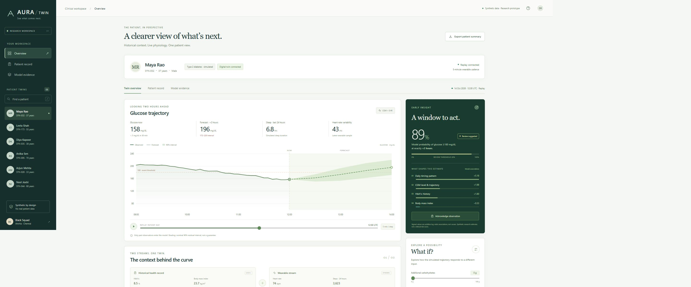

# AURA Twin

### See what comes next.

**A synthetic patient digital twin that fuses historical EHR context with wearable time series to forecast glucose two hours ahead.**

Built by **Black Squad**, Amrita Vishwa Vidyapeetham, Chennai, for Happiest Health Phase 1 — Prototype & Code Submission.



> Working research prototype. Every patient, record and sensor observation is synthetic. Benchmark results below describe this simulator only; they are not evidence of clinical performance. The app does not diagnose, prescribe or recommend medication changes.

## Run the prototype

Requires **Node.js 20 or newer**. The demo has **zero npm dependencies**, no API key and no internet requirement after download.

```bash
node server.mjs
```

Open **http://localhost:4173**. On Windows, you can double-click `START-DEMO.cmd`.

```bash
npm test              # model correctness and API checks
npm run dev          # optional watch mode
```

Optional Docker launch:

```bash
docker build -t aura-twin .
docker run --rm -p 127.0.0.1:4173:4173 aura-twin
```

The server binds to `127.0.0.1` by default. `HOST` and `PORT` can be supplied as environment variables. This is a local research demo, without clinical authentication or production infrastructure.

## Team and college

| Item | Detail |
|---|---|
| Team | Black Squad |
| College | Amrita Vishwa Vidyapeetham, Chennai |
| Team leader | Banu Sreya V. |
| Team member | Duvvuru Deepak Reddy |
| Project | AURA Twin — Multimodal Patient Digital Twin |

The team leader's phone and email are provided separately for the submission platform rather than published in this repository.

## Problem statement and healthcare use case

A glucose reading describes the present. A clinician reviewing a patient also needs context: recent trends, sleep and activity, historical glucose control and individual metabolic characteristics. These streams are often disconnected. Our proof of concept makes them inspectable together and estimates a future glucose outcome.

**Defined task:** predict glucose at **exactly 120 minutes after the current observation**, and estimate the probability that that value is **at least 180 mg/dL**. This is not a prediction of the first crossing, any spike within the next two hours, or an emergency diagnosis. The 180 mg/dL reference is motivated by the upper bound of the commonly discussed CGM target range; the inclusive `>=180` event is our explicit prototype convention. See [NIDDK's explanation of CGM target ranges](https://www.niddk.nih.gov/health-information/professionals/diabetes-discoveries-practice/clinical-targets-for-continuous-glucose-monitoring-data).

The intended demonstration is a clinician reviewing a fictional adult with elevated glucose history, inspecting model evidence, replaying the patient's sensor timeline, documenting a review and comparing hypothetical scenarios. No clinical action is automated.

## What is implemented

- A clinician dashboard with patient search and switching, historical trends, future trajectory and uncertainty, a historical record view and model evidence.
- Five-minute sensor replay with play/pause and a time scrubber. Predictions are recomputed at the selected observation using only data available at that point.
- Two-stream fusion: static EHR features and dynamic CGM, heart rate, HRV, activity and sleep summaries.
- Four glucose horizons: +30, +60, +90 and +120 minutes; calibrated logistic event probability at +120 minutes.
- Interpretable feature contributions, data-quality checks and prediction abstention when required data are insufficient.
- An explicitly illustrative meal/activity sensitivity explorer. It is not a learned causal treatment model; the trained baseline risk is kept separate.
- Review notes and acknowledgements stored in the browser, plus a downloadable patient report.
- An actual reproducible training pipeline, held-out evaluation, ablation comparison, model export and JavaScript/Python parity tests.

This is a continuously updated software representation of a simulated patient. It is a narrow predictive digital twin proof of concept, not a validated physiological simulator, a general-purpose virtual human or a live device integration.

## Data and privacy

**Data origin:** our own seeded simulator in [`ml/generate.py`](ml/generate.py). No patient records, scraped health information, proprietary data, Synthea export or MIMIC data were used. Synthea is a possible future source, not a dependency or a claimed provenance of our data.

| Stream | Content | Resolution |
|---|---|---|
| Static EHR | Age, sex, BMI, HbA1c, LDL, diabetes duration, fictional diagnoses, medication-history text and a fictional genetic-marker field | One record per patient |
| Dynamic wearable | Glucose (mg/dL), heart rate (bpm), HRV (ms), step count and asleep/awake flag | Five minutes |

The generator creates **240 synthetic patients with four days each**. Eight held-out patients are packaged for the interactive demonstration. Historical diagnosis/medication text and the fictional genetic marker are displayed as context; the arbitrary genetic marker is **not used for prediction**. Sleep is an asleep/awake simulation, not validated sleep-stage classification. The simulator encodes daily meal patterns, HbA1c-dependent response, activity effects, sensor noise and between-patient variation.

No real PHI is required. There are no analytics or third-party requests in the application. Browser notes should contain fictional information only. This architecture makes the submission reproducible; it does not claim HIPAA or DPDP compliance certification.

## Technical stack and model

| Layer | Implementation |
|---|---|
| Interface | HTML, CSS, vanilla JavaScript modules, native SVG charts |
| Application server | Node.js native HTTP server; no runtime third-party packages |
| Training | Python, NumPy, scikit-learn |
| Forecasting | StandardScaler + multi-output Ridge regression |
| Event probability | Logistic regression with validation-set Platt calibration |
| Fusion | Static EHR + trailing sensor summaries + clock features + explicit HbA1c interactions |
| Uncertainty | Per-horizon 90th-percentile absolute validation residuals |
| Inference | Exported JSON coefficients evaluated in JavaScript |
| Verification | Node's built-in test runner; Python-to-JavaScript numerical parity fixtures |
| Documents | PDF architecture, PDF presentation, data/model cards, narration and demo runbook |

These small models run offline, expose their assumptions and permit exact inspection of the inference path. They are deliberate alternatives to an opaque model that cannot be reliably trained or defended within this proof of concept.

## Evaluation and outcome

Patients are assigned to **144 training / 48 validation / 48 test** groups before fitting. Windows from the same patient never cross those splits. Training has 20,160 windows; validation and test each have 6,720. Each window uses at least 24 hours of prior observations and future glucose only as a training/evaluation target. Preprocessing is fitted on training patients; probability calibration, interval widths and the alert operating threshold use validation patients.

The committed full results are in [`data/metrics.json`](data/metrics.json). The following are held-out **synthetic** test results:

| Model | +120 min MAE, mg/dL ↓ | Event AUROC ↑ |
|---|---:|---:|
| **EHR + sensors (fused)** | **10.95** | **0.969** |
| Sensors only | 12.17 | 0.959 |
| EHR only | 19.31 | 0.841 |
| Persistence (last observed glucose) | 22.10 | 0.554 |

The fusion model reduces MAE by approximately **10.1% versus sensors alone** and **50.5% versus persistence on this generator**. Its Brier score is **0.0372**. These gains do not establish real-world utility: the generator explicitly encodes relationships involving EHR features, and regular daily meal patterns are learnable from clock features. Evaluation prevalence is about 8%; high AUROC alone is not a guarantee of useful alerts. Precision, recall, operating threshold, calibration bins, confusion matrices, interval coverage and patient-bootstrap MAE uncertainty are available in the full results and model card.

The app uses a **0.20 review threshold**, selected as the highest threshold on a 0.01 grid achieving at least 80% validation recall. At this frozen threshold, test recall is **83.89%** and precision is **53.23%** (453 true positives, 398 false positives, 87 false negatives). The complete results also retain the 0.50 threshold metrics for comparison. False positives and missed events remain meaningful limitations.

The displayed examples are curated from held-out patients to make the walkthrough clear. This selection does not alter the complete test evaluation. Future observations may be used for retrospective comparison but never enter the forecast features at the chosen cursor.

## Retrain and reproduce

The pretrained export is already included, so Python is optional for the demo.

```bash
python -m venv .venv
# Windows: .venv\Scripts\activate
# macOS/Linux: source .venv/bin/activate
python -m pip install -r ml/requirements.txt
python ml/train.py
npm test
```

The seed is `20261019`. Training regenerates the model, metrics, demo patients and parity fixtures. See the environment versions recorded in `data/metrics.json`; numerical results can vary slightly across library and BLAS versions. Changing patient count or days changes the experiment and requires updating presentation claims.

## API and two-stream ingestion

| Method | Endpoint | Response |
|---|---|---|
| GET | `/api/health` | Prototype health and synthetic-data flag |
| GET | `/api/patients` | Packaged synthetic EHR and time-series records |
| GET | `/api/patients/:id` | One complete synthetic patient |
| GET | `/api/metrics` | Actual training/evaluation results |
| POST | `/api/predict` | Features, quality, calibrated risk, forecast and explanations |

Send `{ "patientId": "<id returned by the API>", "cursor": 600 }` to predict at a stored observation. Alternatively send `{ "patient": <patient object>, "cursor": 600 }` to ingest an EHR plus time-series object directly. Input validation rejects malformed records. New input is evaluated in memory and not saved. See [`data/SCHEMA.md`](data/SCHEMA.md) for the precise contract.

Optional scenario keys are `mealCarbs` (0–150) and `activityMinutes` (0–90). These are bounded demonstration inputs, not prescriptions. Scenario curves are illustrative arithmetic sensitivities and have no validated causal interpretation.

## Architecture, presentation and demonstration video

- [Architecture diagram (PDF)](docs/AURA_Twin_Architecture.pdf)
- [Project presentation (PDF)](docs/AURA_Twin_Presentation.pdf)
- [Narrated prototype walkthrough (MP4, 21 minutes 54 seconds)](docs/AURA_Twin_Walkthrough.mp4)
- [Video transcript and chapter timestamps](docs/VIDEO_TRANSCRIPT.md)
- [Demo recording runbook](docs/DEMO_RUNBOOK.md)
- [Model and data card](docs/MODEL_DATA_CARD.md)
- [Judge questions and answers](docs/JUDGE_QA.md)
- [Submission checklist](docs/SUBMISSION_CHECKLIST.md)
- [Verification results](docs/VERIFICATION.md)
- [Requirement-to-artifact map](docs/REQUIREMENTS_TRACEABILITY.md)
- [Example exported patient summary](docs/SAMPLE_PATIENT_REPORT.html)
- [Document and video source](scripts/README.md)

**Video status:** a complete 21-minute 54-second narrated presentation walkthrough is included above. It uses actual prototype screenshots and a disclosed locally synthesized voice. Review it before upload. The final **unlisted YouTube video URL is pending** and must be added here before submission. The supplied video exceeds the written brief's **20-minute minimum**. The recording guide also supports replacing it with a team-delivered interactive demo.

**Public repository URL: PENDING — this deliverable is a new local repository.** Publish it as Public, then replace this status with the actual link. Verify both repository and video links in a signed-out/private browser before checking the submission form's public-access boxes.

## Limitations and next validation steps

The model has not been evaluated on real-world patients or devices. It does not model medication dosing, unusual meal schedules, pregnancy, device drift or the full range of metabolic disorders. Marginal prediction intervals can fail for individual patients or shifted populations. Correlated windows are not independent samples; the reported MAE interval bootstraps patients. Missing-data policies are conservative but are not a validated clinical safety system.

Next work would involve consented or appropriately licensed external data, prospective temporal evaluation, clinical expert review, subgroup and distribution-shift studies, sensor integration, causal validation of any intervention simulator, and production access controls. These are future work, not delivered capabilities.

## Open-source license

Project code, documentation, synthetic fixtures and trained coefficients are provided under the [MIT License](LICENSE). NumPy and scikit-learn are separate BSD-licensed training dependencies. Node.js has its own distribution licenses. The offline frontend uses local system fonts and original interface elements. Third-party references are cited for context and are not redistributed as training data.

## References

- [NIDDK — Clinical Targets for Continuous Glucose Monitoring Data](https://www.niddk.nih.gov/health-information/professionals/diabetes-discoveries-practice/clinical-targets-for-continuous-glucose-monitoring-data)
- [scikit-learn — Common pitfalls and recommended practices](https://scikit-learn.org/stable/common_pitfalls.html)
- [Synthea — Synthetic patient generator (potential future integration)](https://synthetichealth.github.io/synthea/)
