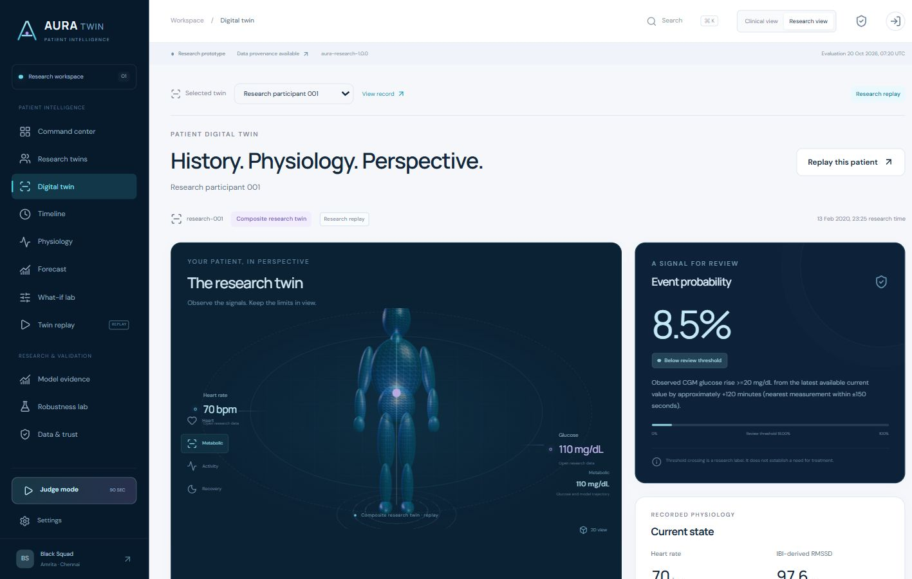

# AURA Twin

### See the patient. Understand what comes next.

**A clinician-oriented Composite Research Twin with actual open research wearables, authentic Synthea EHR context and an inspectable glucose forecast.** Built by **Black Squad**, Amrita Vishwa Vidyapeetham, Chennai.

**Current local rebuild:** `aura-research-1.0.0` · **Primary model:** CGM history only. The EHR and wearable records belong to different people. Their target-blind association demonstrates ingestion and interaction, not physiologically matched clinical fusion.

> This is a research prototype, not clinical validation. The final evaluation has only **three participants**. No diagnosis, dosing, treatment or emergency triage recommendation is provided. Missing sensor channels are not invented.



**[Live demo](https://aura-twin-black-squad.vercel.app)** · **[Public repository](https://github.com/DuvvuruDeepakReddy18/aura-twin-black-squad)**. The current research release at commit `664bc5e7be882153285c31281d2e4c9c25157ecc` was verified on 2026-10-20. Exact release checks, including the deployed model identity and remaining authentication limits, are listed in [VERIFICATION.md](docs/VERIFICATION.md).

## Run locally

Requires Node.js **22.12 or newer**. The current hosted runtime is Node.js 24.

```bash
npm ci
npm run build
npm start
```

Open **http://localhost:4173**. The bundled research demo requires no account. Authentication status: **Google sign-in, profile display and session persistence verified on production.** See [deployment and configuration](docs/DEPLOYMENT.md).

Public email sign-up and password recovery are intentionally disabled until SMTP/email delivery is configured. The Supabase Google provider is now enabled after secure credential configuration, and the public Google feature flag is enabled for Vercel production and preview. Google sign-in completed on production; the signed-in header, account profile and session persistence after a full reload were verified. Email/password registration, recovery, sign-out and token refresh were not verified.

Recording note: Google was not configured when the current PDFs and 23:52 video were recorded. Those assets retain that historical configuration status; [current authentication documentation](docs/DEPLOYMENT.md#authentication-configuration) is authoritative.

```bash
npm test
python -m pip install -r ml/requirements.txt
npm run test:data
```

The final integration suite passed **58 JavaScript tests and 16 Python tests**. Current desktop and narrow-screen UI checks are complete; see the verification record for scope and remaining checks.

## Team

| Role | Name | Roll number |
|---|---|---|
| Leader | Banu Sreya V. | CH.EN.U4ECE23009 |
| Member | Duvvuru Deepak Reddy | CH.EN.U4ECE23015 |

**Team:** Black Squad · **College:** Amrita Vishwa Vidyapeetham, Chennai. Leader phone/email are for the submission platform and are not published in the repository.

## Problem and healthcare use case

A reviewer needs to understand current recorded physiology, possible future glucose and the limits of the prediction. AURA places source context, replay, quality, uncertainty, explanations and a freeze/reveal challenge in one workspace. The model predicts at approximately +30, +60, +90 and +120 minutes.

**Current event:** Observed CGM glucose rise >=20 mg/dL from the latest available current value by approximately +120 minutes (nearest measurement within ±150 seconds).

The target was selected by a predeclared **training-only** support audit. The actual future CGM sample must be within ±150 seconds of the nominal horizon; outcomes are not interpolated. It is not an arbitrary probability or a guaranteed new adverse episode.

## Data origins and identity boundary

- **Wearables:** [PhysioNet BIG IDEAs v1.1.3](https://physionet.org/content/big-ideas-glycemic-wearable/1.1.3/), 16 de-identified research participants, actual CGM/HR/IBI with publisher checksum verification.
- **EHR context:** Official Synthea sample CSV, pinned source commit, 16 adult profiles filtered to 2019-01-01. [Provenance and selection](docs/SYNTHEA_PROVENANCE.md).
- **Composite association:** Independent source-ID/UUID rank assignment. These are different people. Unmatched EHR model families are negative controls, excluded from primary selection.
- **Matched study context:** Source HbA1c and sex are linked to wearable participants; HbA1c measurement timing is unspecified and treated as a baseline assumption.
- **Unavailable:** Sleep stages, steps, activity and genetics are not fabricated. RMSSD is derived from accepted IBI differences, not clinical ECG HRV.

## Measured evidence

Participants are split **9 fit / 2 selection / 2 calibration / 3 final**, with all windows from one person kept together. Primary selection uses participant-macro +120-minute MAE. The model and policy are frozen before final evaluation.

| Model family | +120 MAE mg/dL | Recall | Precision | FN / FP windows |
|---|---|---|---|---|
| CGM only | 13.31 | 66.20% | 22.14% | 97 / 668 |
| CGM + HR + RMSSD | 13.70 | 84.67% | 19.35% | 44 / 1,013 |
| Matched research fusion | 14.73 | 82.93% | 22.88% | 49 / 802 |
| Unmatched EHR only | 14.80 | 100.00% | 15.44% | 0 / 1,572 |
| Unmatched composite | 13.76 | 76.66% | 20.52% | 67 / 852 |
| Persistence | 16.35 | 0.00% | 0.00% | 287 / 0 |

These results use the same **1,859 final windows**. FN and FP are overlapping windows, not unique clinical events. Current +120-minute empirical interval coverage is **93.54%** and mean width **71.68 mg/dL**. The review threshold **0.180** is selected on calibration participants, not final outcomes.

The small selection/calibration/final samples limit generalization. See the [current model and data card](docs/MODEL_DATA_CARD.md), [machine-readable metrics](data/research-metrics.json), [protocol](data/research-protocol.json), [freeze record](data/research-freeze.json) and [source manifest](data/research-manifest.json).

The separate [runtime perturbation audit](docs/ROBUSTNESS_AUDIT.md) samples 496 windows and includes withheld forecasts in its denominator. It is not the same evaluation as the 1,859-window model comparison.

## Product and technical stack

React, Vite, React Router, Three.js / React Three Fiber / Drei, a Node.js API, exported numerical tree inference, Python/scikit-learn training and ReportLab submission documents. Supabase authentication is configuration-dependent; demo access remains separate. The current UI exposes recorded sources and the prediction contract. Explanations are nonadditive reference sensitivity, not causal effects or SHAP.

Challenge Lab freezes a cutoff-bounded prediction, reveals original recorded truth, compares persistence and exports evidence. Hashes detect inconsistent artifacts; they do not provide trusted signatures or independent timestamps. The verification record lists exact implemented stress cases and tested UI flows.

## Legacy synthetic evidence

V3 synthetic artifacts remain historical engineering evidence and cannot be numerically compared with the new research target/cohort. The full earlier synthetic application is available locally at **http://localhost:4173/legacy/index.html**, clearly labelled legacy.

The independent V4 experiment has its own protocol and fresh synthetic identities. **Predeclared promotion gate failed; not promoted.** It does not validate the open-research model. On the same fresh synthetic cohort it reduced false-positive windows but increased primary false-negative windows. [Same-cohort V4 comparison](docs/SYNTHETIC_V4_EXPERIMENT.md) · [Machine-readable results](data/synthetic-v4-experiment/results.json).

## Submission material

- [Architecture PDF](docs/AURA_Twin_Architecture.pdf)
- [Presentation PDF](docs/AURA_Twin_Presentation.pdf)
- [Timed demonstration runbook](docs/DEMO_RUNBOOK.md)
- [Current model/data card](docs/MODEL_DATA_CARD.md)
- [Source provenance](docs/SYNTHEA_PROVENANCE.md)
- [Verification record](docs/VERIFICATION.md)
- [Requirements traceability](docs/REQUIREMENTS_TRACEABILITY.md)
- [Submission checklist](docs/SUBMISSION_CHECKLIST.md)

**[Current demonstration MP4](docs/AURA_Twin_Walkthrough.mp4): 23:52** (1,431.877687 seconds), with 22 chapters matching the current research edition. Duration and complete decoding are verified. The external unlisted video URL remains pending.

## License and attribution

Application code is under the [MIT License](LICENSE). Third-party datasets have their own terms: BIG IDEAs uses the [Open Data Commons Attribution License 1.0](https://physionet.org/content/big-ideas-glycemic-wearable/view-license/1.1.3/); official Synthea sample terms and the [Walonoski et al. citation](https://doi.org/10.1093/jamia/ocx079) are documented separately. [Complete source references](docs/SOURCE_REFERENCES.md) include the original wearable study and platform citations. Application licensing does not replace source-data attribution.
