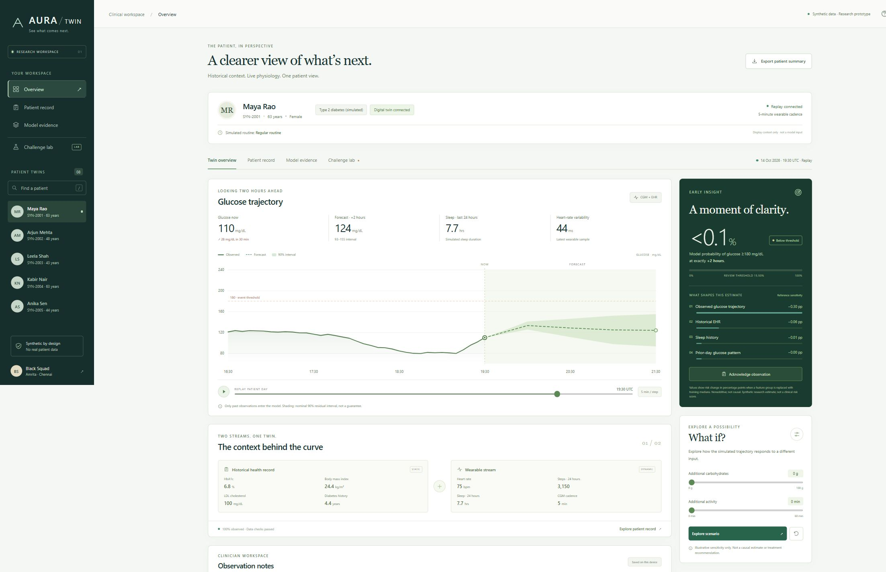

# AURA Twin

### See what comes next. Inspect the evidence.

**A working synthetic patient digital twin that fuses historical EHR context with wearable time series to forecast glucose two hours ahead.** Built by **Black Squad**, Amrita Vishwa Vidyapeetham, Chennai, for Happiest Health Phase 1.

**Current model: `aura-synthetic-3.0.0`.** This edition targets missed-positive and false-positive windows together using richer past-derived features, decision-aligned model selection and a new final cohort. On the same 100,800 fresh final windows, missed positives changed from **1,742 to 1,669**, and false-positive flags from **8,730 to 8,170**. The comparison is between frozen policies on identical observations, not different cohorts or a threshold tuned on the final test. The gains are modest and mixed: the patient-bootstrap 95% interval for the FN difference includes zero, and the withheld combination has **324 → 330 missed positive windows**. This does not establish a reliable reduction in misses or improvement across every routine.

**[Open the live prototype](https://aura-twin-black-squad.vercel.app)** · **[Watch the 26-minute demonstration](https://aura-twin-black-squad.vercel.app/docs/AURA_Twin_Walkthrough.mp4)** · **[Public GitHub repository](https://github.com/DuvvuruDeepakReddy18/aura-twin-black-squad)**



> Every patient and observation is generated. This is synthetic benchmark evidence, not clinical validation. The app does not diagnose, prescribe or recommend treatment, and receives no future meal schedule. Counts below are overlapping windows, not unique clinical events.

## Run locally

Requires **Node.js 20+**. After downloading the package, the local dashboard needs no npm dependency installation, external model account or internet connection.

```bash
node server.mjs
```

Open **http://localhost:4173**. On Windows, double-click `START-DEMO.cmd`. The server binds to localhost by default.

```bash
npm test
npm run test:data
```

Optional Docker: `docker build -t aura-twin .`, then `docker run --rm -p 127.0.0.1:4173:4173 aura-twin`. Hosted configuration and its synthetic-only input boundary are in [DEPLOYMENT.md](docs/DEPLOYMENT.md).

## Team and college

| Item | Detail |
|---|---|
| Team | Black Squad |
| College | Amrita Vishwa Vidyapeetham, Chennai |
| Leader | Banu Sreya V. |
| Member | Duvvuru Deepak Reddy |
| Project | AURA Twin — Multimodal Patient Digital Twin |

Leader phone/email belong in the submission platform and are not published here.

## Problem and healthcare use case

A current glucose reading lacks historical context and the recent trajectory needed to interpret changing state. AURA combines a fictional EHR with simulated wearable observations, forecasts a future state and lets a clinician inspect the evidence.

**Task:** glucose at +30, +60, +90 and +120 minutes, plus probability of **glucose ≥180 mg/dL at exactly +120 minutes**. This is not any excursion during two hours or necessarily a new onset. Inclusive 180 is a prototype convention; [NIDDK](https://www.niddk.nih.gov/health-information/professionals/diabetes-discoveries-practice/clinical-targets-for-continuous-glucose-monitoring-data) provides the common 70–180 mg/dL context. Individual clinical targets are outside scope.

## Implemented product

- Clinician overview, searchable patient selection, record view, model evidence and Challenge Lab.
- Five-minute replay, pause/scrub controls, four forecast horizons and descriptive residual bands.
- Fusion through **108 clock-free past-only features**: EHR, glucose trajectory, HR/HRV, activity, sleep and observed previous-day history.
- Degraded-data handling and abstention for substantial missing or stale observations.
- Nonadditive group-reference sensitivity in risk percentage points; not SHAP or causal attribution.
- Illustrative meal/activity arithmetic sandbox with trained risk unchanged.
- Browser-local notes/acknowledgements and downloadable patient summary.
- Freeze → reveal → compare with persistence → export a reproducible receipt.
- Four sensor cases: clean replay, 10-minute gap, 30-minute dropout and plausible CGM bias.
- Hosted freeze/reveal across instances using a temporary authenticated encrypted snapshot; public API restricted to packaged synthetic IDs.

This is a runnable conceptual clinician workflow. Usability benefit, clinical outcomes and intervention efficacy have not been measured.

## Data and model

The seeded [generator](ml/generate.py) produces all fictional EHR and five-minute glucose, HR, HRV, steps and asleep/awake observations. No real records, PHI, Synthea exports, MIMIC data or device accounts are used. Genetic-marker and medication text are display context only. Sleep is not clinical sleep-stage classification.

There are **1,064 identities** across fitting, selection, calibration and final evaluation. Six routine families are used during development. A separate final case combines a 3-hour meal shift, 1-hour jitter, day-shift SD 1.4 hours, skip probability 0.25 and variable sleep/activity. This exact combination is withheld; its factors are familiar. The simulator is unchanged for the v2/v3 comparison.

No future meals, routine labels or hidden simulator states enter inference. Horizon-aligned previous-day readings were observed 22–23.5 hours earlier. They can describe recurrence, not reveal today's unannounced meal. Simulated HR includes a contemporaneous meal response, which may favor prediction under this generator.

| Layer | Implementation |
|---|---|
| Frontend | HTML/CSS, vanilla JavaScript, SVG charts |
| Runtime | Native Node.js HTTP handler; zero third-party runtime packages |
| Hosting | Vercel static files and Node.js function; same model evaluator |
| Training | Python, NumPy, scikit-learn histogram gradient boosting |
| Forecast | Four absolute-error regressors; 360 iterations, 63 leaves |
| Risk | 300-iteration, 31-leaf classifier plus separate Platt calibration |
| Inputs | 108 raw, clock-free past-only features |
| Policy | One global threshold selected on calibration identities |
| Uncertainty | Per-horizon 90th-percentile absolute calibration residuals |
| Explanation | Feature-group replacement by training medians |

## Evaluation protocol

| Role | Identities | Windows | Purpose |
|---|---:|---:|---|
| Fit | 768 | 322,560 | Fit candidates; 60-minute stride |
| Select | 80 | 67,200 | Select candidate; 30-minute stride |
| Calibrate | 96 | 80,640 | Probability mapping, bands and global threshold |
| Primary final | 120 | 100,800 | Six familiar routine families |
| Withheld combination | Same 120 | 16,800 | Separate stress result, excluded from primary aggregate |

Final identities **SYN-2001–SYN-2120** are generated after model, calibration, threshold and interval bytes are frozen. All variants/windows of one identity stay together. The local hash/code sequence is auditable, not independent preregistration or a trusted timestamp. See [protocol](data/robustness-protocol.json), [selection evidence](data/selection-results.json), [freeze record](data/model-freeze.json), [audit](data/training-audit.json), [metrics](data/metrics.json) and [robustness results](data/robustness.json).

Classifier selection minimizes the worst FP/FN count ratio to frozen v2 across overall, pooled irregular and variable-routine windows, with one threshold. Regression selection minimizes +120-minute MAE. Calibration is separate from fitting/selection, and final evaluation never chooses another winner. This is a prototype objective, not a clinically established error-cost function.

## Measured current outcome

| Frozen policy | Threshold | Recall | Precision | FN windows | FP windows | +120 MAE mg/dL |
|---|---|---|---|---|---|---|
| Previous v2 | 0.1600 | 73.36% | 35.46% | 1,742 | 8,730 | 11.39 |
| Current v3 | 0.1550 | 74.47% | 37.34% | 1,669 | 8,170 | 10.85 |

The frozen v3 policy at 0.1550 has 74.47% recall and 37.34% precision, with 1,669 false-negative and 8,170 false-positive windows. Frozen v2 on the same cases has 1,742 FN and 8,730 FP. The gains are modest and mixed: the patient-bootstrap 95% interval for the FN difference includes zero, and the withheld combination has **324 → 330 missed positive windows**. This does not establish a reliable reduction in misses or improvement across every routine. Event prevalence is 6.49%. These are correlated exact-horizon windows. Lowering a threshold alone cannot establish improved discrimination; paired final counts, ranking metrics and calibration evidence are all retained.

| V3 minus V2 | Difference | Patient-bootstrap 95% interval |
|---|---|---|
| False-positive windows | −560 | −980.025 to −157.975 |
| False-negative windows | −73 | −192.025 to +27.025 |
| Recall, percentage points | +1.12 | −0.49 to +2.79 |
| Precision, percentage points | +1.88 | +0.97 to +2.93 |

Differences are v3 minus frozen v2; negative favors v3 for FP/FN, positive for recall/precision. Bootstrap resamples patient identities and preserves paired routine variants.

| Routine | V2 → V3 FN | V2 → V3 FP | V3 recall | V3 precision | V3 MAE |
|---|---|---|---|---|---|
| Regular routine | 211 → 212 | 1,207 → 1,134 | 82.57% | 46.96% | 9.38 |
| Meals delayed by 2 hours | 164 → 159 | 1,366 → 1,370 | 85.64% | 40.90% | 9.10 |
| Meals delayed by 4 hours | 132 → 142 | 1,332 → 1,195 | 84.58% | 39.46% | 9.01 |
| Irregular meal timing | 491 → 452 | 1,541 → 1,384 | 65.26% | 38.02% | 13.05 |
| Daily timing changes and skipped meals | 324 → 313 | 1,627 → 1,490 | 69.13% | 31.99% | 11.97 |
| Variable sleep, activity and meals | 420 → 391 | 1,657 → 1,597 | 60.06% | 26.91% | 12.59 |
| Held-out combination of shifted and variable routines | 324 → 330 | 1,657 → 1,624 | 60.99% | 24.11% | 12.07 |

The final row is the separate withheld combination, not part of the primary mean. The separate withheld factor combination has 12.07 mg/dL MAE, 60.99% recall and 24.11% precision. FN changes 324 → 330; FP changes 1,657 → 1,624. A combined improvement does not guarantee improvement in every family or window.

| Model | +120 MAE mg/dL | AUROC | AP | Brier |
|---|---|---|---|---|
| Current fused | 10.850 | 0.9340 | 0.5648 | 0.0400 |
| Frozen v2 | 11.392 | 0.9243 | 0.5211 | 0.0422 |
| Sensor only | 10.925 | 0.9316 | 0.5546 | 0.0406 |
| EHR only | 17.904 | 0.8199 | 0.1841 | 0.0555 |
| Persistence | 20.081 | 0.5506 | 0.0800 | 0.1090 |

Sensor-only minus fused MAE is **0.075 mg/dL**; the EHR increment is measured rather than assumed. Persistence has a hard 0/1 event output, not comparable probability calibration. At +120 minutes, nominal 90% bands have **90.60%** primary coverage and **61.76 mg/dL** mean width. No per-patient or shifted-population coverage guarantee is made.

Current-below-threshold, already-high and rising/falling slices, full uncertainty, hyperparameters and limitations are in the [model/data card](docs/MODEL_DATA_CARD.md) and [stress audit](docs/STRESS_AUDIT.md). Historical artifacts remain under `data/baseline-v1/` and `data/baseline-v2/`; their old scores are not current results.

## Challenge Lab and receipts

Choose a patient, cutoff and sensor case, then **Freeze prediction → Reveal recorded future → Download receipt**. Inference sees a physically truncated perturbed prefix. Reveal compares the saved output with original future readings without recomputing it. Public data makes this a computation boundary, not secure study blinding. Missing futures or abstention do not receive fabricated scores. Persistence sees the same perturbed current value; plausible bias can pass quality gates.

```bash
node scripts/verify_receipt.mjs path/to/receipt.json
```

The verifier checks raw-model-byte and canonical-input SHA-256 plus recomputed predictions/reveals. Hashes are not signatures or trusted timestamps. Local sessions are memory-only, capped at 128 and expire after an hour. Hosted snapshots use authenticated encryption, expire after an hour, and are invalidated by key/model changes; their transport token is omitted from receipts. See [deployment behavior](docs/DEPLOYMENT.md).

## Reproduce training

Python is optional for the dashboard. Use a fresh output/cache directory for reproduction:

```bash
python -m venv .venv
# Activate the environment for your platform.
python -m pip install -r ml/requirements.txt
npm run train
npm run train:freeze
npm run train:evaluate
npm test
npm run test:data
```

These scripts execute the `develop`, `freeze` and `evaluate` phases of `ml/train_v3.py`, writing to `work/reproduced-v3` with `work/reproduced-v3-cache`. They do not overwrite shipped or archived artifacts. The fixed seed is 20261019. Final locks prevent retuning and rerunning the same final evaluation. Reproduction after reading results does not make those identities untouched for a new experiment. `npm run train:legacy` remains an isolated v1 reproduction.

## API

| Method | Endpoint | Purpose |
|---|---|---|
| GET | `/api/health` | Version and synthetic flag |
| GET | `/api/patients`, `/api/patients/:id` | Packaged fictional records |
| GET | `/api/metrics`, `/api/robustness`, `/api/stress` | Current evaluation and comparisons |
| POST | `/api/predict` | Past-only prediction |
| GET | `/api/challenge/modes` | Sensor conditions |
| POST | `/api/challenge` | Freeze patient/cursor/mode |
| POST | `/api/challenge/reveal` | Compare original frozen output with future |

Prediction accepts `{"patientId":"<API patient ID>","cursor":600}`. Local development also accepts a validated synthetic `patient` object; the hosted adapter rejects arbitrary patient objects. See [schema](data/SCHEMA.md). Do not enter real patient information.

## Required submission artifacts

- [Architecture PDF](docs/AURA_Twin_Architecture.pdf), [22-slide presentation PDF](docs/AURA_Twin_Presentation.pdf), [Challenge Lab supplement](docs/AURA_Twin_Challenge_Lab.pdf).
- [Full narration](docs/narration.json), [video transcript](docs/VIDEO_TRANSCRIPT.md), [demo runbook](docs/DEMO_RUNBOOK.md), [three-minute challenge](docs/JURY_CHALLENGE_SCRIPT.md).
- [Differentiation and pitch](docs/DIFFERENTIATION.md), [model/data card](docs/MODEL_DATA_CARD.md), [jury Q&A](docs/JUDGE_QA.md), [verification](docs/VERIFICATION.md).
- [Submission checklist](docs/SUBMISSION_CHECKLIST.md), [requirements map](docs/REQUIREMENTS_TRACEABILITY.md), [document/video sources](scripts/README.md), [deployment guide](docs/DEPLOYMENT.md).
- [MIT license](LICENSE); dependencies retain their own licenses.

**Current demonstration video:** [watch the public walkthrough — 26:24](https://aura-twin-black-squad.vercel.app/docs/AURA_Twin_Walkthrough.mp4), or use the [repository MP4](docs/AURA_Twin_Walkthrough.mp4). The 22-chapter recording uses the current V3 slides and locally synthesized Microsoft Zira narration. Its exact duration is 1,584.109961 seconds; the complete file passed decoding verification and the public host serves it without authentication. An unlisted YouTube upload has not been created.

**Live prototype:** [aura-twin-black-squad.vercel.app](https://aura-twin-black-squad.vercel.app). Anonymous API checks confirm the current V3 model, hosted freeze/reveal and offline verification of its downloaded receipt. The [presentation](https://aura-twin-black-squad.vercel.app/docs/AURA_Twin_Presentation.pdf), [architecture](https://aura-twin-black-squad.vercel.app/docs/AURA_Twin_Architecture.pdf) and main MP4 are served publicly. The local folder is `Black Squad_Amrita Vishwa Vidyapeetham Chennai`. The team must provide leader contact details on the submission platform; see the [final checklist](docs/SUBMISSION_CHECKLIST.md) for remaining submission steps.

## Limits and related work

Unknown future meals, abrupt changes, plausible sensor bias, medication effects, new devices/generators and real-world complexity remain unresolved. Local notes are demo state. No clinical authentication, outcome study, compliance certification or treatment recommendation is provided.

Prior twin/counterfactual work includes [GlyTwin](https://arxiv.org/abs/2504.09846); no first-in-field or cross-dataset accuracy claim is made. The [VVUQ perspective](https://www.nature.com/articles/s41746-025-01447-y) motivates verification and validation, not certification of this implementation. [Threshold selection](https://scikit-learn.org/stable/modules/classification_threshold.html) and [probability calibration](https://scikit-learn.org/stable/modules/calibration.html) are distinct. [Unannounced-meal detection research](https://pmc.ncbi.nlm.nih.gov/articles/PMC5876595/) concerns observing a response after a meal, not foreknowledge of future meals. [Synthea](https://synthetichealth.github.io/synthea/) is a possible future integration, not a source used here.
